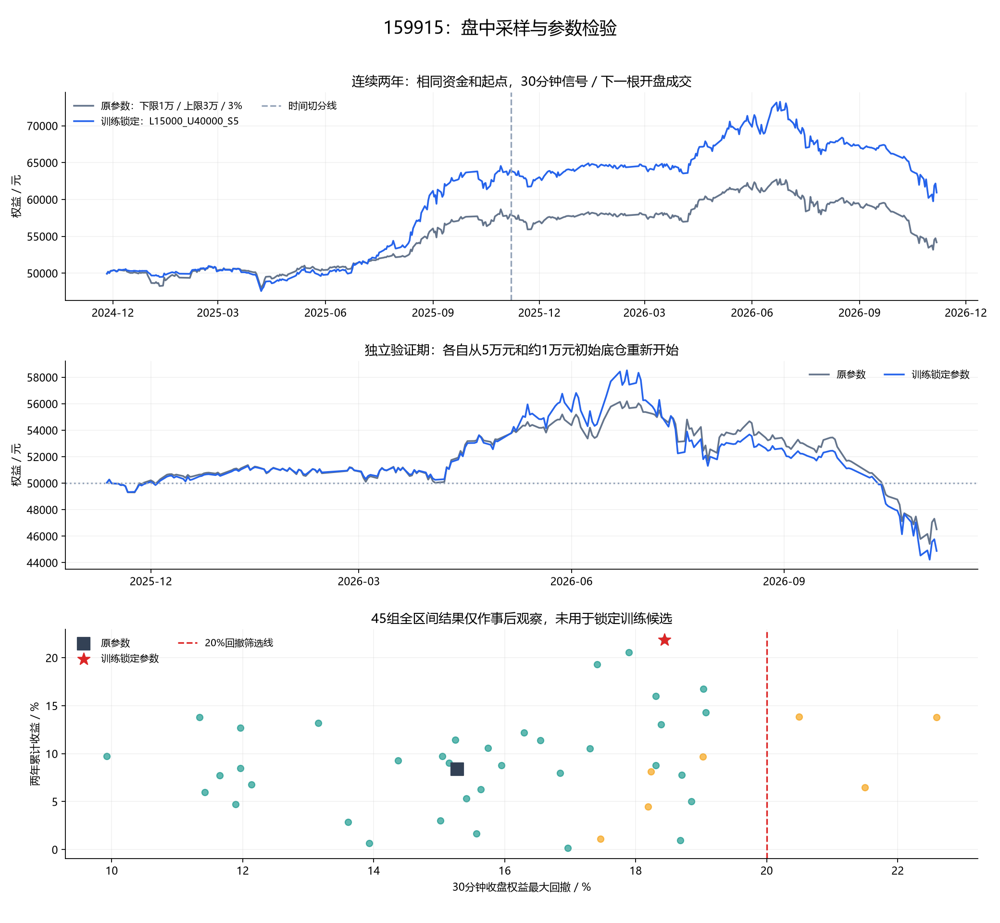

# 159915：盘中回测及45组参数检验

> 研究日期：2026年11月7日。目标：历史最大回撤不超过20%，兼顾收益及执行稳定性。

## 1. 结论与边界

训练期预先锁定候选：**下限15000元、上限40000元、步长5.00%**。中线随上下限取平均，其他参数保持相同。

锁定候选未能在验证期两种滑点下都满足20%回撤限制，因此本轮不能将它作为符合目标的替代参数。未按验证收益另换赢家。

全部收益均已扣佣金。这里的回撤指30分钟收盘权益回撤，不是逐笔盘中真实最大回撤，也不保证未来回撤。

## 2. 日线与盘中有何差异

| 执行方式，原参数 | 两年收益 | 最大回撤 | 成交笔数 | 佣金 |
|---|---:|---:|---:|---:|
| 日线收盘／次日开盘 | 8.55% | 14.28%（日收盘） | 68 | 340.00 |
| 30分钟收盘／下一根开盘 | 8.36% | 15.28%（30分钟收盘） | 97 | 485.00 |

两者共用起点选择规则、总资金和初始底仓。30分钟允许同日多笔，但每根最多一笔；收盘信号在下一根开盘执行，午休及隔夜按真实下一个bar处理。不使用同根高低价安排更有利的成交顺序，也不声称每个实际触价都成交。

## 3. 搜索空间及预先固定的选择规则

| 项目 | 设定 |
|---|---|
| 下限 | 5000、10000、15000元 |
| 上限 | 20000、30000、40000元 |
| 步长 | 2%、3%、4%、5%、6%；固定比例网格 |
| 合计 | 45组，包含原参数10000／30000／3% |
| 保持相同 | 总资金50000、初始底仓约10000、每笔约4000、100份整手、完整订单越界、T+1、双边万2.5最低5元 |
| 训练期 | 2024-11-07—2025-11-06 |
| 验证期 | 2025-11-07—2026-11-06 |

初始底仓始终约10000元，调整下限不会同步改变起始投入；所以下限15000元时，初始成本可能低于下限。沿用原初始化正向规则，只有后续常规成交才触发阶段切换。上下限仍是阶段阈值，不是严格仓位硬边界。

选择步骤在读取验证结果之前执行并写入[selection_lock.json](../selection_lock.json)：

1. 训练期零滑点及双边各0.001元不利滑点两种场景，回撤均不得超过20%。
2. 近邻定义为只移动一个候选档位、其他两项相同；将自身也纳入，至少一半近邻满足风险要求。
3. 比较该邻域每组最差滑点收益的中位数，优先选整体较好的区域；再比自身最差收益、较低回撤及固定ID。
4. 锁定一个候选后才查看验证。若失败，明确报告，不换成验证期赢家。

训练与验证各自用相同50000元和约10000元底仓独立初始化；两年连续账户另行计算。独立验证收益不能与训练收益直接拼接。2026此前已经看过，属于时间切分检验，不是真正未见样本。

## 4. 原参数与锁定候选

| 参数 | 训练收益0／1档滑点 | 验证收益0／1档滑点 | 验证回撤0／1档滑点 | 两年收益0／1档滑点 | 两年回撤0／1档滑点 |
|---|---:|---:|---:|---:|---:|
| L10000_U30000_S3 | 15.97% / 15.92% | -6.97% / -7.58% | 19.18% / 19.65% | 8.36% / 8.11% | 15.28% / 16.74% |
| L15000_U40000_S5 | 27.99% / 27.83% | -10.24% / -10.31% | 24.43% / 24.45% | 21.87% / 21.65% | 18.44% / 18.36% |



### 邻域稳定性

锁定候选的训练邻域最差滑点收益中位数为27.27%，邻域含自身共5组，训练风险达标比例100.00%。

| 邻近参数 | 训练最差滑点收益 | 验证最差滑点收益 | 验证最坏回撤 | 两年最差滑点收益 |
|---|---:|---:|---:|---:|
| L10000_U40000_S5 | 22.78% | -11.77% | 22.68% | 19.13% |
| L15000_U30000_S5 | 23.67% | -5.38% | 19.83% | 15.75% |
| L15000_U40000_S4 | 27.27% | -10.71% | 25.67% | 20.55% |
| L15000_U40000_S5 | 27.83% | -10.31% | 24.45% | 21.65% |
| L15000_U40000_S6 | 29.77% | -7.92% | 22.92% | 13.67% |

### 事后全区间观察，不作为锁定候选

45组中，在两年两种滑点回撤均≤20%的前提下，按最差滑点收益最高者为`L15000_U40000_S5`，两年零滑点／一档滑点收益分别为21.87%／21.65%。它使用了整段历史，只是样本内观察，不能冒充独立验证推荐。

### 二次探索候选（已使用验证结果，不算独立验证成功）

锁定候选失败后，以下只用于提出后续研究假设，不修改原锁定结果。筛选同时要求全区间及验证期在两种滑点下回撤≤20%。收益型取全区间最差滑点收益较高者；均衡型还要求收益不低于原参数，按最差收益／最坏回撤比选择。这不是夏普比率，也不是预先锁定的推荐。

| 事后候选 | 参数 | 两年收益0／1档 | 两年回撤0／1档 | 验证收益0／1档 | 验证回撤0／1档 |
|---|---|---:|---:|---:|---:|
| 收益型 | L15000_U30000_S5 | 16.02% / 15.75% | 18.31% / 18.47% | -5.30% / -5.38% | 19.82% / 19.83% |
| 均衡型 | L15000_U20000_S4 | 13.79% / 13.86% | 11.34% / 11.23% | -3.79% / -3.63% | 16.09% / 15.91% |

如果后续需要选择观察对象，均衡型历史回撤余量更大；但它已用本轮数据筛选，必须等待新增未用行情或其他未用标的验证，不能重新包装成样本外成功。

## 5. 最近完整区间的5分钟复核

5分钟源提供最近5001根，首日不完整，剔除2026-06-04。保留104个完整交易日，2026-06-05 09:35:00—2026-11-06 15:00:00，每日48根；与30分钟使用共同日期、共同起点和资金。原参数和训练锁定候选在5分钟检验前已确定，另列的探索候选来自事后筛选；均不利用5分钟结果重新调参。

| 性质 | 参数 | 采样 | 实际建仓日 | 收益0／1档滑点 | 回撤0／1档滑点 |
|---|---|---|---|---:|---:|
| 原参数 | L10000_U30000_S3 | 30分钟 | 2026-06-12 | -16.74% / -17.14% | 20.43% / 20.18% |
| 原参数 | L10000_U30000_S3 | 5分钟 | 2026-06-12 | -14.93% / -15.01% | 19.08% / 19.14% |
| 训练锁定 | L15000_U40000_S5 | 30分钟 | 2026-06-12 | -19.41% / -19.29% | 22.59% / 22.44% |
| 训练锁定 | L15000_U40000_S5 | 5分钟 | 2026-06-12 | -19.53% / -19.62% | 23.04% / 23.12% |
| 事后收益型 | L15000_U30000_S5 | 30分钟 | 2026-06-12 | -15.38% / -15.22% | 18.50% / 18.32% |
| 事后收益型 | L15000_U30000_S5 | 5分钟 | 2026-06-12 | -15.60% / -15.66% | 19.06% / 19.11% |
| 事后均衡型 | L15000_U20000_S4 | 30分钟 | 2026-06-12 | -13.19% / -13.04% | 16.27% / 16.11% |
| 事后均衡型 | L15000_U20000_S4 | 5分钟 | 2026-06-12 | -13.24% / -13.33% | 16.39% / 16.45% |

该区间较短且行情不同，不能用其收益代替两年结果；5分钟也不是逐笔触价回测。

## 6. 执行、资金与数据核验

- [30分钟原始来源](https://money.finance.sina.com.cn/quotes_service/api/json_v2.php/CN_MarketData.getKLineData?symbol=sz159915&scale=30&ma=no&datalen=5000)：3880根、485个完整交易日，每天8根。
- [5分钟原始来源](https://money.finance.sina.com.cn/quotes_service/api/json_v2.php/CN_MarketData.getKLineData?symbol=sz159915&scale=5&ma=no&datalen=24000)：完整日与原两年日线逐日核对OHLC一致。
- 原始响应、SHA-256及时间范围保存在data目录；两年日线已做腾讯与新浪双来源核对。
- 信号记录bar序号及结束时间，成交记录下一根序号及开始时间。相邻bar交界可同一钟点，但绝不在产生该信号的同一根bar开盘成交。
- 券商成熟持仓只按日历日比较；当天买入不能因为经过半小时就变成可卖。记账匹配与券商批次独立。
- 每bar核对现金＋市值＝初始资金＋已实现毛利＋浮动毛利−全部已付费用；期末再核对净盈亏守恒。
- 未模拟买卖盘口、集合竞价排队、涨跌停封单；下一根开盘可成交是一项假设。
- 不改动既有日线及半年回测文件，不改App代码。

## 7. 复现及完整产物

```powershell
python -m unittest discover -s research/position_following_v2 -p 'test_*.py' -v
python research/position_following_v2/optimize_intraday.py
```

- `../selection_lock.json`：查看验证结果之前写入的候选、训练结果哈希及预定规则。
- `parameter_grid.csv`：全部45组训练、验证、连续两年结果，零滑点及一档滑点都保留。
- `study_results.json`：完整机器可读汇总。
- `original_full_*`、`selected_full_*`、`original_validation_*`、`selected_validation_*`：成交、事件、每bar权益、逐日权益；文件名后缀`1tick`为一档滑点。
- `five_minute_*`：共同区间的高低频核验成交与权益。
