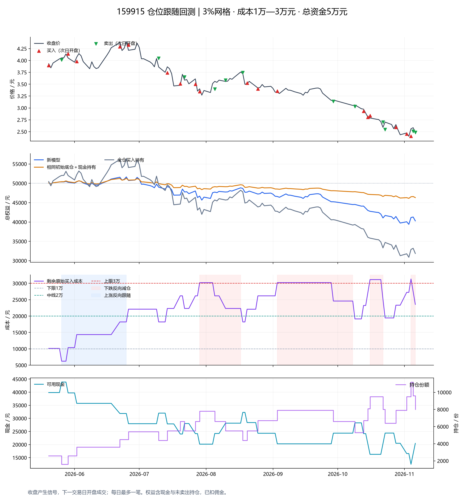

# 159915 正向／反向仓位跟随：独立模型与半年回测

> 研究日期：2026年11月7日。主参数及阶段规则先确定，再运行行情；未用结果挑参数。App源码未改动。

## 1. 先看主回测结果

在 2026-05-20 建仓至 2026-11-06 的 116 个交易日内，50000元变为 **40,296.90元**，净盈亏 **-9,703.10元**，收益率 **-19.41%**，按每日收盘权益计算的最大回撤 **23.72%**。

| 方案 | 期末权益 | 收益率 | 最大回撤 |
|---|---:|---:|---:|
| 新模型 | 40,296.90元 | -19.41% | 23.72% |
| 相同初始底仓＋现金不动 | 46,316.00元 | -7.37% | 10.10% |
| 相同总资金全仓买入持有 | 31,875.54元 | -36.25% | 45.22% |

这两个基准分别回答：主动加减仓是否优于保留同样底仓，以及是否优于一开始全部投入。全仓基准的风险暴露更高，不能只凭跑赢全仓基准就认定网格有效。



## 2. 已确认参数与执行口径

| 项目 | 主回测设定 |
|---|---|
| 标的 | 159915，易方达创业板ETF |
| 数据窗口 | 2026-05-07—2026-11-06，125根真实日线 |
| 初始资金／底仓 | 50000元／约10000元，之后不追加资金 |
| 实际建仓 | 2026-05-20 开盘，3.895元 × 2600份，裸成本10,127.00元 |
| 成本下限／中线／上限 | 10000／20000／30000元；成本为剩余原始买入价×份额 |
| 每次交易 | 约4000元，按实际开盘成交价折成最接近的100份整数倍，最低100份 |
| 边界 | 整笔成交，允许跨过上限、下限和中线；资金／盈利批次／可卖量不足则取消整笔 |
| 价格网格 | 固定锚点×1.03ⁿ，0.001元四舍五入，不随成交偏差重置 |
| 信号／成交 | 收盘到达新格子后判断，下一交易日开盘；每天最多一笔 |
| 主场景费用 | 双边佣金万2.5，每笔最低5元；无印花税及股票过户费；滑点0 |
| T+1 | 实际卖出量不能超过此前交易日买入的券商可卖量 |
| 期末 | 按最后收盘价计价，不强制卖出，不预扣未发生的清仓佣金 |

固定比例网格上行相邻档为3%，下行相邻档为1−1/1.03≈2.9126%。这样上涨和下跌使用相同格子编号；若改用成交价每次±3%，格子会漂移，需另定义占格规则。

## 3. 起点怎样选，怎样避免偷看未来

预先规定：数据窗口前22根日线中，首次出现连续两日收盘下降，且这两日累计跌幅在1%—6%之间，就在下一交易日开盘建仓。找不到则报告无法满足起点，不另挑盈利日期。

本次首次识别日为 **2026-05-19**，建仓日为 **2026-05-20**。规则只查看识别日及之前收盘，不把事后局部最高点或最低点当作已知起点。

初始约10000元作为一个特殊底仓批次占用0号格；即使整手取整后略低于下限，初始化仍从正向阶段开始。初始信号不是一次常规网格买入。

## 4. 模型状态机

| 当前阶段 | 下跌到新格 | 上涨到新格 | 实际成交后的切换 |
|---|---|---|---|
| 正向 | 空格买入 | 最低买价盈利批次优先卖出 | 买后成本≥30000转下跌减仓；卖后成本≤10000转上涨跟随 |
| 下跌反向减仓 | 最高买价批次优先卖出，可亏损 | 有足够盈利批次才止盈，否则等待 | 成本≤20000恢复正向 |
| 上涨反向跟随 | 真正空格可买，已占格等待，不因回落减仓 | 突破最高剩余买价且格子为空才买 | 成本≥20000恢复正向 |

阶段只在实际成交后改变。等待及报价反弹不会自行清除原阶段。到中线的那笔成交完成后才切换，不在同一天同一个信号再做一笔相反交易。

格子剩余数量>0即占用；部分卖出不释放，全部卖完才能再次买入。每笔卖出按当前价格折算约4000元，可依次消耗多个符合条件的批次，也可只消耗某批次的一部分。盈利只指卖价高于原买价，净利润另扣费用。

收盘跨越多格只在最远到达格产生一个候选信号，不按日高低价编造盘中先后。即使等待，行情访问格也会推进，从而能识别反弹后重新下跌。次日开盘按已确定的方向执行，并重新检查现金、占格、盈利批次或突破条件；条件失效则取消，不改做另一方向。

## 5. 实际交易与阶段切换

共30笔成交，含初始底仓：买入18笔，卖出12笔；已付佣金150.00元。

| 操作原因 | 成交笔数 |
|---|---:|
| 初始底仓 | 1 |
| 正向上涨止盈 | 3 |
| 反向上涨跟随 | 3 |
| 跟随途中回落空格买入 | 1 |
| 正向下跌买入 | 13 |
| 减仓途中反弹止盈 | 5 |
| 反向下跌减仓 | 4 |

| 切换日期 | 操作 | 成交价／份额 | 成交后成本 | 阶段变化 |
|---|---|---|---:|---|
| 2026-05-26 | 正向上涨止盈 | 4.012 × 1000 | 6,232.00 | 正向 → 上涨反向跟随 |
| 2026-06-26 | 反向上涨跟随 | 4.328 × 900 | 22,113.10 | 上涨反向跟随 → 正向 |
| 2026-07-29 | 正向下跌买入 | 3.346 × 1200 | 30,198.40 | 正向 → 下跌反向减仓 |
| 2026-08-18 | 减仓途中反弹止盈 | 3.748 × 1100 | 18,218.10 | 下跌反向减仓 → 正向 |
| 2026-09-03 | 正向下跌买入 | 3.357 × 1200 | 30,211.00 | 正向 → 下跌反向减仓 |
| 2026-10-09 | 反向下跌减仓 | 3.029 × 1300 | 19,139.50 | 下跌反向减仓 → 正向 |
| 2026-10-16 | 正向下跌买入 | 2.840 × 1400 | 31,144.50 | 正向 → 下跌反向减仓 |
| 2026-10-23 | 反向下跌减仓 | 2.549 × 1600 | 19,437.40 | 下跌反向减仓 → 正向 |
| 2026-11-04 | 正向下跌买入 | 2.405 × 1700 | 31,338.50 | 正向 → 下跌反向减仓 |

### 等待及撤单

| 环节 | 原因 | 次数 |
|---|---|---:|
| 收盘未发单 | 格子仍有持仓 | 10 |

## 6. 期末资金与盈亏核对

| 项目 | 数值 |
|---|---:|
| 现金 | 20,456.90元 |
| 持仓 | 8000份，7个占用格 |
| 剩余原始买入成本 | 23,573.50元 |
| 期末市值 | 19,840.00元 |
| 已实现净盈亏（已扣卖出及所配买入费） | -5,940.12元 |
| 剩余持仓浮动净盈亏（已扣剩余买入费） | -3,762.98元 |
| 最低现金余额 | 12,478.10元 |
| 持仓成本范围 | 6,232.00—31,338.50元 |
| 最多越过上限／低于下限 | 1,338.50／3,768.00元 |
| 期末阶段 | 下跌反向减仓 |

逐日核对：权益＝现金＋持仓市值＝初始资金＋已实现毛盈亏＋浮动毛盈亏−已付全部佣金。期末还核对已实现净盈亏＋剩余浮动净盈亏＝总净盈亏，避免只报告卖出盈利而遗漏浮亏。

## 7. 本轮暴露的策略取舍

**整体账户没有盈利。** 跑赢全仓持有约16.84%个百分点，但比相同初始底仓＋现金持有少6,019.10元。这段行情先涨后大幅下跌，主动增加持仓带来了更多下跌敞口；不能把较低初始仓位带来的优势全部归于网格。

### 已实现损益按操作原因拆分

| 卖出类型 | 笔数 | 已实现净盈亏 |
|---|---:|---:|
| 正向上涨止盈 | 3 | 395.95元 |
| 减仓途中反弹止盈 | 5 | 341.21元 |
| 反向下跌减仓 | 4 | -6,677.29元 |

反向减仓把部分浮亏转成已实现亏损，同时减少后续持仓并回收现金。仅凭这几笔亏损不能断言减仓更差；若要归因，需要另做关闭反向规则、其他条件相同的完整权益对照。本次没有为改善结果修改任何规则。

### 完整一份越界会明显改变底仓

初始成本10,127.00元，第一次上涨卖出约4000元后，成本降到6232元，立即进入上涨反向跟随。也就是说，这套整份规则中的10000元是切换阈值，不能被理解为任何时候都保留10000元底仓。本轮最低成本低于下限3768元；如果目标是严格保底，下一轮需要修改整份成交与边界的优先级。

### 反向回中线仍可能反复补仓

本轮持仓最高达到11200份，日均市值约20,420.76元。反向减仓到中线后恢复下跌买入，后续继续跌就可能再走一次上限—中线循环。这保证了持续操作能力，但并未自动控制累计亏损或判断底部；成本区间控制不能代替总权益回撤控制。

### 盈利批次不保证扣费后盈利

2026-08-18的反弹卖出毛利9.90元，扣买卖费用后净亏0.10元。这是当前采用裸价盈利条件的直接结果；若改为净盈利门槛，应作为下一版明确规则重新回测。

## 8. 执行成本与资金敏感性（未调整模型参数寻找最优）

| 场景 | 初始资金 | 期末权益 | 收益率 | 最大回撤 | 成交数 |
|---|---:|---:|---:|---:|---:|
| 主场景 | 50,000.00 | 40,296.90 | -19.41% | 23.72% | 30 |
| 双边各1个最小价位滑点 | 50,000.00 | 40,258.10 | -19.48% | 23.78% | 30 |
| 无最低佣金、费率仍为万2.5 | 50,000.00 | 40,415.39 | -19.17% | 23.54% | 30 |
| 总资金30000元诊断 | 30,000.00 | 20,343.30 | -32.19% | 37.70% | 22 |

资金30000元仅保留为诊断对照，主方案仍为用户最后确认的50000元。不同初始资金的收益率分母不同，不能直接据此认定资金多或少的策略更优。

## 9. 数据来源与局限

- [腾讯未复权日线](https://web.ifzq.gtimg.cn/appstock/app/fqkline/get?param=sz159915,day,2026-04-01,2026-11-06,640,)：成交和资金核算使用未复权OHLC，原始响应已保存并记录SHA-256。
- [腾讯前复权交叉检查](https://web.ifzq.gtimg.cn/appstock/app/fqkline/get?param=sz159915,day,2026-04-01,2026-11-06,640,qfq)：样本内原始与前复权每日OHLCV一致，未检测到复权差异。这不是对所有基金公告的逐份审计；若未来数据存在分红或份额折算，程序会拒绝运行，需先显式处理。
- [深交所ETF交易说明](https://investor.szse.cn/warning/activities/fundIntroduction/t20210104_584079.html)：100份整手、0.001元报价、只计佣金而不计股票印花税。实际券商ETF佣金可能不同。
- [新浪独立日线](https://money.finance.sina.com.cn/quotes_service/api/json_v2.php/CN_MarketData.getKLineData?symbol=sz159915&scale=240&ma=no&datalen=300)：重叠125个交易日，OHLC不一致日期0个；原始响应同样保留。
- 日线收盘采样会漏掉盘中触格后回撤；因此这是所确认的日线执行版本，不能等同盘中实时网格收益。
- 默认次日开盘价可成交，未模拟集合竞价排队、涨跌停封单、停牌或成交冲击；1个最小价位滑点场景仅做粗略压力检查。
- 只有约半年、一个ETF、一个预先定义的起点，不能据此证明长期有效，也不能判断未来低点。
- 成本是记账指标；选择最高／最低价批次不会改变同数量同价卖出的现金流，却会改变剩余成本与后续阶段。
- 成本上下限允许整份越过，实际超出幅度取决于卖出时消耗的原始成本，不保证只偏差几元。

## 10. 复现与产物

```powershell
python -m unittest discover -s research/position_following_v2 -p 'test_*.py' -v
python research/position_following_v2/backtest.py
# Re-download only when intentionally refreshing the frozen snapshot:
python research/position_following_v2/backtest.py --refresh-data
```

- `model.py`：纯状态机及格子、费用、T+1、资金核对。
- `backtest.py`：数据快照、确定起点、逐日执行、基准、图表与本报告。
- `data/`：原始行情、规范化日线和数据来源元信息。
- `outputs/trades.csv`：全部成交，含信号日、成交日、格子、匹配批次及阶段前后。
- `outputs/events.csv`：全部跨格事件、等待原因及开盘撤单。
- `outputs/daily.csv`：逐日现金、股数、成本、权益及两个基准。
- `outputs/results.json`：主结果与诊断场景的完整数字。
