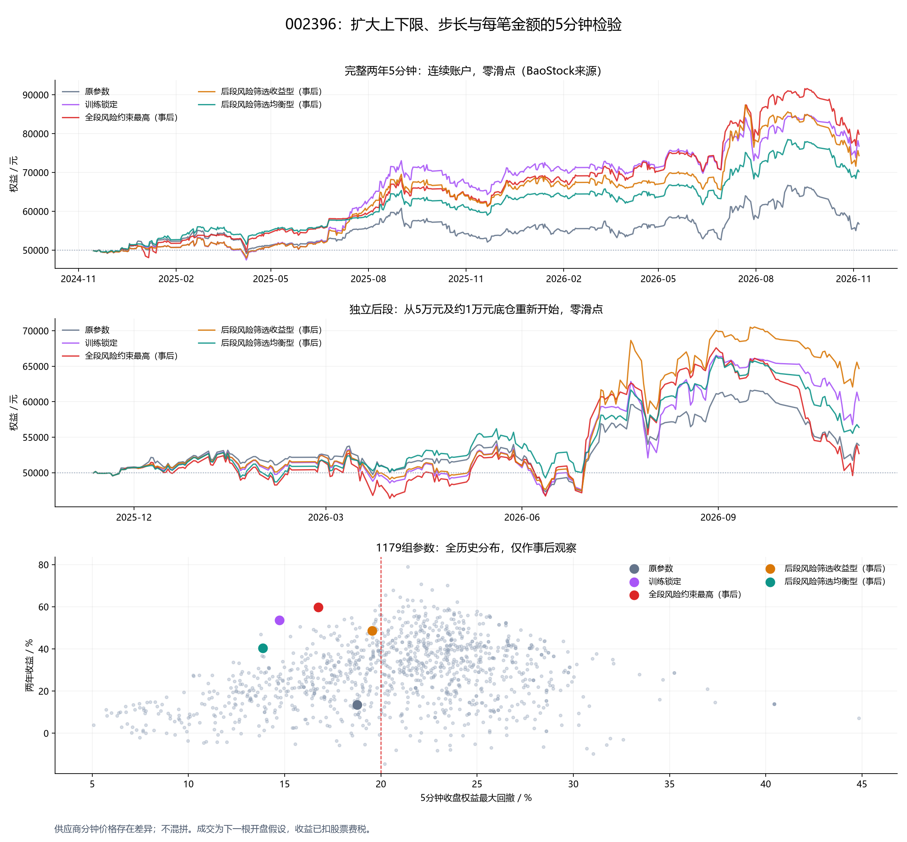

# 002396：完整两年5分钟、四维参数搜索

> 研究日期：2026年11月7日。本金入金上限50000元，收益与历史回撤兼顾，回撤筛选线20%。

## 1. 数据质量先说明

本轮取得2024年11月7日至2026年11月6日的 **23280根真实供应商5分钟记录、485个完整交易日**，没有将30分钟拆分、插值成5分钟，也没有混拼供应商价格。1分钟公开来源仅覆盖很短区间，不足以做两年搜索。

**分钟数据存在明显供应商差异，不能因周期更细就认为回测更接近真实成交。** BaoStock与独立日线的每日开盘、收盘485天均一致；但275天聚合最高价、262天聚合最低价不同（可能重叠），差值最大分别为0.35／0.19元，均在独立日线真实区间内。

最近新浪4992根中，4199根至少一个OHLC字段不同（约84.11%）；开盘／收盘最大差0.29／0.21元。这不是可忽略的分位舍入差。

因此：两年主研究使用完整BaoStock5分钟；候选另用同日期、同起点的新浪5分钟核验。来源差异保留在快照质量字段，不修改原价让它们看起来一致。结论只适合作为继续研究的候选，不能称已确认最佳参数。

## 2. 搜索范围与资金约束

| 维度 | 粗搜索 | 局部细化 |
|---|---|---|
| 成本下限 | 0、5000、10000、15000、20000、25000、30000元 | 训练种子±2500元 |
| 成本上限 | 10000、20000、30000、40000、45000、50000元 | 训练种子±2500元 |
| 百分比步长 | 1%、2%、3%、4%、5%、6%、8%、10% | ±0.5个百分点 |
| 每笔目标金额 | 2000、4000、6000、8000元 | ±1000元 |

过滤下限＜上限后粗搜1056组；细化中心126组，合计1179组不同候选。训练近邻支持点另计，不把它们当成已在验证／全段搜索过的候选。

细化边界固定为下限0—30000、上限10000—50000、步长1%—10%、每笔目标1000—10000元。初始底仓仍约10000元，不随下限或每笔金额变化。中线始终是上下限平均。

**50000元限制的是本金净投入，不是累计买入成交额。** 不追加资金、不借款，现金不得为负；盈利和分红留在账户内可再用。资金不足时取消完整订单，不用模型外现金补足。上限是阶段阈值，按此前确认的完整一份规则可跨过；获利再投入时，账面成本或市值可能超过50000元，这不表示追加了本金。

费用、T+1、分红转增、网格仿射除权、日终净减股数红利税FIFO均沿用上一轮股票模型。一档滑点为每侧0.01元，主表分别列零／一档；回撤为5分钟收盘权益回撤，不是逐笔最大回撤。

## 3. 先锁定再检验

训练2024年11月7日—2025年11月6日；验证2025年11月7日—2026年11月6日，独立从相同本金与底仓初始化。

1. 粗筛在训练期同时要求两档滑点回撤≤20%；按固定粗网格邻域最差收益中位数排序，邻域含自身至少一半风险合格。
2. 依次取粗网格距离至少2的前三个种子区域，四维各±一档生成细中心，补齐其实际物理近邻训练结果。
3. 细筛要求至少4个唯一且非自身的实际近邻；固定±2500／±2500／±0.5%／±1000，不因插入新点改变邻居定义。
4. 仍仅用训练结果锁定一个候选，随后才计算验证及全区间。锁定失败不换成验证赢家。

锁定为 **下限7500／上限50000／步长10%／每笔目标9000元**。完整两年和独立后段账户不能拼接；002396的后段此前已经看过，这仍是时间切分检验，不是真正未见行情。

## 4. 主要结果

下表0／1档均已扣交易费税和已发生红利税，含分红转增；期末不强制清仓。

| 性质 | 参数 | 两年收益0／1档 | 两年回撤0／1档 | 后段收益0／1档 | 后段回撤0／1档 | 全部展示风险检查≤20% |
|---|---|---:|---:|---:|---:|---|
| 原参数 | 下限10000／上限30000／步长3%／每笔目标4000元 | 13.47% / 17.63% | 18.76% / 16.80% | 7.71% / 10.66% | 16.71% / 16.40% | 是 |
| 训练锁定 | 下限7500／上限50000／步长10%／每笔目标9000元 | 53.54% / 53.31% | 14.73% / 14.76% | 20.35% / 6.46% | 19.09% / 22.52% | 否 |
| 全段风险约束最高（事后） | 下限5000／上限50000／步长6%／每笔目标8000元 | 59.69% / 59.11% | 16.74% / 16.84% | 5.37% / 5.01% | 27.95% / 28.06% | 否 |
| 后段风险筛选收益型（事后） | 下限7500／上限50000／步长10%／每笔目标7000元 | 48.63% / 48.43% | 19.55% / 19.55% | 29.35% / 29.23% | 16.56% / 16.58% | 否 |
| 后段风险筛选均衡型（事后） | 下限10000／上限30000／步长8%／每笔目标8000元 | 40.37% / 40.34% | 13.86% / 13.88% | 12.75% / 13.01% | 17.29% / 17.28% | 是 |

‘全部展示风险检查’同时检查两年、独立后段及近期两来源，在零／一档滑点下均≤20%。这只是本次有限历史的筛选，不能保证未来回撤。

‘全段风险约束最高’指两档全段回撤均≤20%时，按两档较低收益选出的最高者，不是完全不限制风险的最高收益。

**训练锁定候选不通过验证时，不构成优化成功。** ‘全段风险约束最高’使用了整段历史；‘后段风险筛选’两组更使用了后段结果，都是事后探索，不是独立验证赢家。

本轮展示候选中通过全部风险检查的有：后段风险筛选均衡型（事后）、原参数。



## 5. 实际每笔金额与资金占用

目标金额会折成最接近的100股整手，最低100股。股价较高时，即使目标1000／2000元，实际也可能是2000—4000元，多个名义金额可能产生同一交易行为。以下不含初始建仓。

| 参数性质，零滑点完整两年 | 每笔目标 | 实际最小／中位／最大 | 成交数含建仓 | 费用 | 最低现金 | 最大原始成本 |
|---|---:|---:|---:|---:|---:|---:|
| 原参数 | 4000 | 2,682.00 / 3,648.00 / 5,330.00 | 281 | 1,679.52 | 22,775.58 | 34,582.00 |
| 训练锁定 | 9000 | 7,214.00 / 8,836.00 / 10,692.00 | 42 | 303.08 | 14,436.39 | 45,832.70 |
| 全段风险约束最高（事后） | 8000 | 6,488.00 / 8,157.00 / 9,435.00 | 113 | 801.48 | 5,497.50 | 54,832.60 |
| 后段风险筛选收益型（事后） | 7000 | 5,800.00 / 6,572.00 / 8,268.00 | 40 | 267.82 | 20,659.51 | 45,596.80 |
| 后段风险筛选均衡型（事后） | 8000 | 6,478.00 / 8,042.00 / 9,420.00 | 63 | 449.37 | 22,348.79 | 33,356.00 |

## 6. 相同日期的供应商核验

共同建仓日 **2026-06-25**；两来源都从50000元、约10000元初始底仓重新开始，参数不因该核验再次调优。该区间仅为近期完整5分钟的覆盖，不替代两年结果。

| 参数性质 | 来源 | 收益0／1档 | 回撤0／1档 |
|---|---|---:|---:|
| 原参数 | baostock | 15.88% / 14.82% | 15.96% / 16.13% |
| 原参数 | sina | 16.00% / 15.76% | 15.90% / 16.00% |
| 训练锁定 | baostock | -6.87% / -7.01% | 32.38% / 32.43% |
| 训练锁定 | sina | -8.45% / -8.58% | 32.79% / 32.84% |
| 全段风险约束最高（事后） | baostock | 6.41% / 6.10% | 26.49% / 26.56% |
| 全段风险约束最高（事后） | sina | 6.45% / 5.84% | 26.44% / 26.65% |
| 后段风险筛选收益型（事后） | baostock | -4.47% / -6.46% | 30.06% / 30.42% |
| 后段风险筛选收益型（事后） | sina | -4.44% / -4.56% | 30.11% / 30.17% |
| 后段风险筛选均衡型（事后） | baostock | 15.25% / 14.75% | 19.05% / 19.18% |
| 后段风险筛选均衡型（事后） | sina | 15.13% / 14.94% | 19.07% / 19.15% |

近期来源差异和起点变化都可能改变路径。滑点后收益更高不代表滑点有利，而是锚点、整手取整、占格及阶段切换不同；不得只挑收益较高的一档展示。

## 7. 数据、模型与复现

- 原始逐月BaoStock CSV、总快照与SHA-256保存在data目录；明确使用不复权`adjustflag=3`。
- BaoStock不支持本次所需两年1分钟；公开东方财富1分钟仅近5日且部分开盘字段缺失，未据此伪造长期精细成交。
- 校验完整交易时段、17位时间格式、485×48根、日开收一致及价格范围；来源差异模式须显式开启。
- 每根5分钟结束判断，下一根开盘执行，每根最多一笔，不能还原一根内多次穿格。
- 快速搜索与原完整账本引擎逐字段回归；所有展示候选再用完整引擎复算并导出实际成交和税务现金流。
- 旧股票及ETF报告、JSON未覆盖；新邻居防御校验未改变任何合法邻域或选择。缓存格式与依赖补齐的逐行不变证明见[首次迁移](../cache_scheme_migration.json)及[依赖补齐迁移](../cache_dependency_migration.json)，原训练锁定点与训练摘要哈希保持相同。

```powershell
python -m unittest discover -s research/position_following_v2 -p 'test_*.py' -v
python research/position_following_v2/stock_five_search.py --workers 4
```

- `parameter_grid.csv`：全部候选四维参数与训练、验证、全段的两档结果。
- `results.json`：展示候选、全部结果和跨源核验。
- `../training_lock.json`：查看验证之前的锁定点、种子、训练摘要哈希及原时间。
- `*_trades.csv`、`*_cashflows.csv`、`*_marks.csv`、`*_daily.csv`：完整可审计台账。
