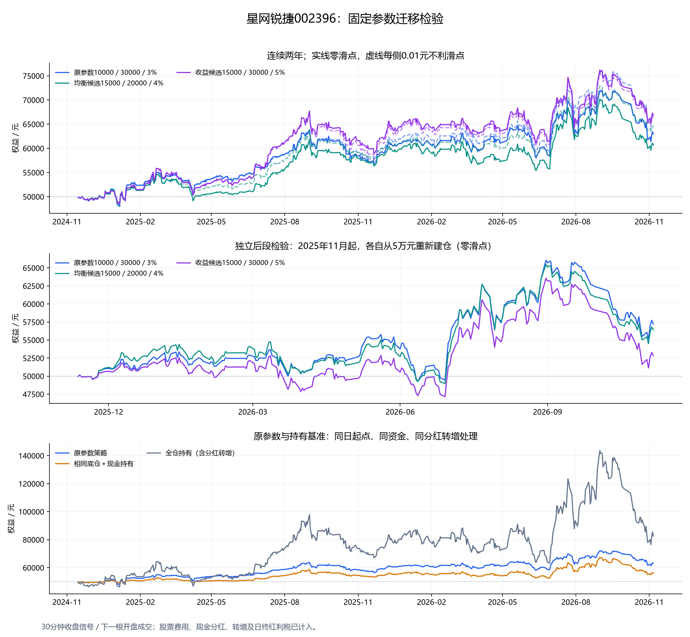

# 星网锐捷002396：固定三组参数的两年迁移回测

> 研究日期：2026年11月7日。本轮未对002396重新搜索参数；三组均来自此前159915研究。

窗口2024年11月7日至2026年11月6日，485个交易日、3880根30分钟K线。按相同小幅下跌起点规则于 **2024-11-15** 建仓，实际运行479个交易日。

## 1. 连续两年结果

总资金50000元，初始底仓约10000元，每笔约4000元；改变下限不改变初始投入。初始仍从正向阶段开始，完整一份成交允许跨过成本上下限和中线。

| 参数 | 期末权益，零滑点 | 收益0／1档滑点 | 回撤0／1档滑点 | 成交数，零滑点 | 交易费税，零滑点 |
|---|---:|---:|---:|---:|---:|
| 原参数10000／30000／3% | 62,973.55 | 25.95% / 32.98% | 15.80% / 15.30% | 199 | 1,187.45 |
| 均衡候选15000／20000／4% | 60,702.09 | 21.40% / 28.75% | 15.94% / 14.09% | 130 | 779.41 |
| 收益候选15000／30000／5% | 66,888.66 | 33.78% / 32.53% | 15.53% / 15.64% | 80 | 481.84 |

所有收益均含已到账分红、已实扣红利税和交易费税，期末持仓按收盘计价、不强制卖出。回撤是30分钟收盘权益回撤，不能等同逐笔盘中真实最大回撤。股票一档为0.01元。

**滑点后收益可能更高，不代表滑点有利。** 初始成交锚点、格子触发、整数股数和后续阶段均依赖成交价格；这会改变订单路径。原参数与均衡候选两种滑点的收益差较大，应视为路径敏感性，不能只展示较高的一档。



## 2. 独立后段检验

后段窗口为2025年11月7日至2026年11月6日，各组都重新从50000元和约10000元底仓开始，使用同样的起点条件，不能与连续两年收益拼接。参数没有根据该股票后段结果改选。

| 参数 | 建仓日 | 收益0／1档 | 回撤0／1档 | 两档回撤均≤20% |
|---|---|---:|---:|---|
| 原参数10000／30000／3% | 2025-11-12 | 14.40% / 15.61% | 17.71% / 17.11% | 是 |
| 均衡候选15000／20000／4% | 2025-11-12 | 12.84% / 11.27% | 18.01% / 18.52% | 是 |
| 收益候选15000／30000／5% | 2025-11-12 | 5.65% / 5.75% | 20.77% / 20.81% | 否 |

这只股票上，完整区间收益最高不等于后段风险符合要求；收益候选5%组的后段回撤超过20%。原参数在两档滑点的后段检验中均低于20%，且后段收益高于另两组。这是跨标的研究证据，不是未来回撤保证，也不能证明单一参数适合所有股票。

## 3. 与159915相同参数对照

| 参数 | 159915两年收益／回撤，零滑点 | 002396两年收益／回撤，零滑点 |
|---|---:|---:|
| 原参数10000／30000／3% | 8.36% / 15.28% | 25.95% / 15.80% |
| 均衡候选15000／20000／4% | 13.79% / 11.34% | 21.40% / 15.94% |
| 收益候选15000／30000／5% | 16.02% / 18.31% | 33.78% / 15.53% |

股票使用0.01元报价、股票税费；ETF使用0.001元报价及ETF费用。两者遵循相同起点条件，但实际建仓日期不同：002396为2024年11月15日，159915为11月26日。所以这是参数迁移观察，不是严格同时建仓的标的排名；标的也不是随机抽样，不能据此认定002396未来更适合。

## 4. 买入持有基准

| 原参数对应基准 | 期末权益 | 两年收益 | 30分钟收盘回撤 |
|---|---:|---:|---:|
| 策略 | 62,973.55 | 25.95% | 15.80% |
| 相同底仓＋现金持有 | 56,032.41 | 12.06% | 19.57% |
| 50000元尽量全仓持有 | 82,589.68 | 65.18% | 48.71% |

两个基准也按同日开盘买入、相同买入费用，接收现金分红及转增股份；不将复权价当实际资金成交价。全仓暴露更高，收益及回撤应同时看。

## 5. 分年表现（连续账户，零滑点）

| 参数 | 年份 | 净盈亏 | 年内收益率 |
|---|---|---:|---:|
| 原参数10000／30000／3% | 2024 | 552.90 | 1.11% |
| 原参数10000／30000／3% | 2025 | 10,822.44 | 21.41% |
| 原参数10000／30000／3% | 2026 | 1,598.21 | 2.60% |
| 均衡候选15000／20000／4% | 2024 | 669.96 | 1.34% |
| 均衡候选15000／20000／4% | 2025 | 9,680.38 | 19.10% |
| 均衡候选15000／20000／4% | 2026 | 351.75 | 0.58% |
| 收益候选15000／30000／5% | 2024 | 489.80 | 0.98% |
| 收益候选15000／30000／5% | 2025 | 14,813.53 | 29.34% |
| 收益候选15000／30000／5% | 2026 | 1,585.33 | 2.43% |

2024年和2026年均非完整年度；以该段开始前的账户权益为分母，不逐年重置资金或持仓。

## 6. 分红、转增、网格与红利税

| 事件 | 实际股东权益 | 价格参考参数 |
|---|---|---|
| [2025-05-30](https://epaper.stcn.com/pic/202505/23/996a1d12f9f266da34b4c8d61efd3e25.pdf) | 每股现金0.25元；登记日05-29 | 每股除息参考0.2487976元 |
| [2026-05-25](https://static.cninfo.com.cn/finalpage/2026-05-15/1225307722.PDF) | 每股现金0.25元，10转3；登记日05-22 | 参考现金0.2487916，参考转增0.2985500 |

实际到账比例与价格参考比例不同，原因是公司回购专户不参与分配。持仓股数按实际1.3倍增加、原始批次成本保持相同，每股成本相应下降；现金分红计入现金和收益，不再减买入成本。

每个固定格子按公告公式整体变换：2025年P'=P−0.2487976；2026年P'=(P−0.2487916)/1.2985500。采用scale×原网格＋offset的复合仿射变换，保留格子编号和阶段，不只改锚点重建等比网格。除权日前已排队的信号按预定规则取消，等调整后的新bar再判断，不按当天行情择优保留。若恰好除权日才新建仓，则不获得之前登记权益，也不再次调整已除权的初始锚点。

转增股到账日可卖，与普通当天买入的T+1冻结分开。转增会产生30、60、90股零股，只要格子仍有股票就占用；常规买卖仍按100股整手及完整每份规则。本轮转增前持仓均为整手，新增数量均为整数股，没有不足1股的随机分配问题。

红利税另设FIFO账，与记账高低价匹配、券商可卖批次分开。派息先到账，按每日日终净减股数结算：持有≤1个自然月税率20%，超过1个月但≤1个自然年10%，超过1年免税，周年当日仍在含当天的边界。同日卖出又买回、净持仓未减少，不按盘中卖出逐笔补扣。税额在当日收盘扣除，比券商后续实际划扣时刻略保守。

新增转增股份单列为到账日取得的税务批次，不附带原股的历史现金分红权利。该新增股份税务取得日未找到足够明确的权威细则，列为假设；取得日可能影响FIFO顺序，进而影响原有股份历史红利税的补扣。不能因其后没有新分红就断言税额不受影响。本轮固定成交路径的替代排序核验见[验证记录](验证记录.md)。期末未卖出的潜在税额另报，不冒充已实际扣税。

| 参数（零滑点） | 分红到账 | 已扣红利税 | 期末若全卖潜在红利税 | 佣金 | 印花税 | 过户费 |
|---|---:|---:|---:|---:|---:|---:|
| 原参数10000／30000／3% | 375.00 | 40.00 | 0.00 | 995.00 | 185.01 | 7.44 |
| 均衡候选15000／20000／4% | 275.00 | 27.50 | 0.00 | 650.00 | 124.45 | 4.96 |
| 收益候选15000／30000／5% | 450.00 | 45.00 | 0.00 | 400.00 | 78.73 | 3.11 |

股票交易费用口径：双边佣金万2.5、每笔最低5元；双边过户费万0.1；卖出印花税0.05%。各费用分项按分四舍五入，实际券商结算可能有分位差异。

规则资料：[财税2015-101号](https://www.chinatax.gov.cn/chinatax/n810341/n810765/n1465977/n1466017/c1967339/content.html)、[中国结算FAQ转载](https://www.csrc.gov.cn/shenzhen/c105614/c1575308/content.shtml)、[印花税减半公告](https://www.mof.gov.cn/jrttts/202308/t20230828_3904235.htm)。

## 7. 近期5分钟复核

最近完整区间2026-06-05 09:35:00—2026-11-06 15:00:00，共104天；首个不完整日已剔除。30分钟与5分钟使用共同日期、共同起点及资金，仍不重新选参数。

| 参数 | 采样 | 建仓日 | 收益0／1档 | 回撤0／1档 |
|---|---|---|---:|---:|
| 原参数10000／30000／3% | 30分钟 | 2026-06-25 | 12.80% / 13.35% | 16.62% / 15.71% |
| 原参数10000／30000／3% | 5分钟 | 2026-06-25 | 16.00% / 15.76% | 15.90% / 16.00% |
| 均衡候选15000／20000／4% | 30分钟 | 2026-06-25 | 11.63% / 11.26% | 16.72% / 16.84% |
| 均衡候选15000／20000／4% | 5分钟 | 2026-06-25 | 14.85% / 13.65% | 14.34% / 14.49% |
| 收益候选15000／30000／5% | 30分钟 | 2026-06-25 | 15.29% / 15.15% | 20.64% / 20.68% |
| 收益候选15000／30000／5% | 5分钟 | 2026-06-25 | 13.27% / 11.89% | 19.85% / 19.85% |

这一短区间不能代替两年，也不能等同逐笔触价成交。

## 8. 数据核验和适用边界

- 两年日线由腾讯未复权与新浪逐日核对；30分钟每天8根，聚合OHLC与日线完全一致。
- 原始与前复权有372天差异，按两次公告价格公式解释全部差异，最大价格误差0.00055739093604404913172385元，小于0.001元。
- 使用真实未复权价格成交，前复权只用于独立核对，不把转增造成的原价跳变当作网格下跌。
- 未模拟盘口、封板无法成交、停牌排队或冲击成本；下一根开盘可成交是一项假设。
- 每bar核对权益＝初资＋交易已实现毛利＋浮动毛利−交易费税＋分红−已扣红利税。
- 三组参数未在002396上重新搜索，不能根据表现再改称此前独立训练的赢家；本轮也只是一只额外股票。

## 9. 复现与产物

```powershell
python -m unittest discover -s research/position_following_v2 -p 'test_*.py' -v
python research/position_following_v2/backtest_stock.py
```

默认冻结快照，`--refresh-data`才重新下载。`results.json`保留全部汇总，`*_trades.csv`含股票费税及实际批次，`*_cashflows.csv`含分红、转增、日终净红利税和FIFO明细，`*_marks.csv`为每bar权益，`yearly.csv`为连续账户的分年表现。
