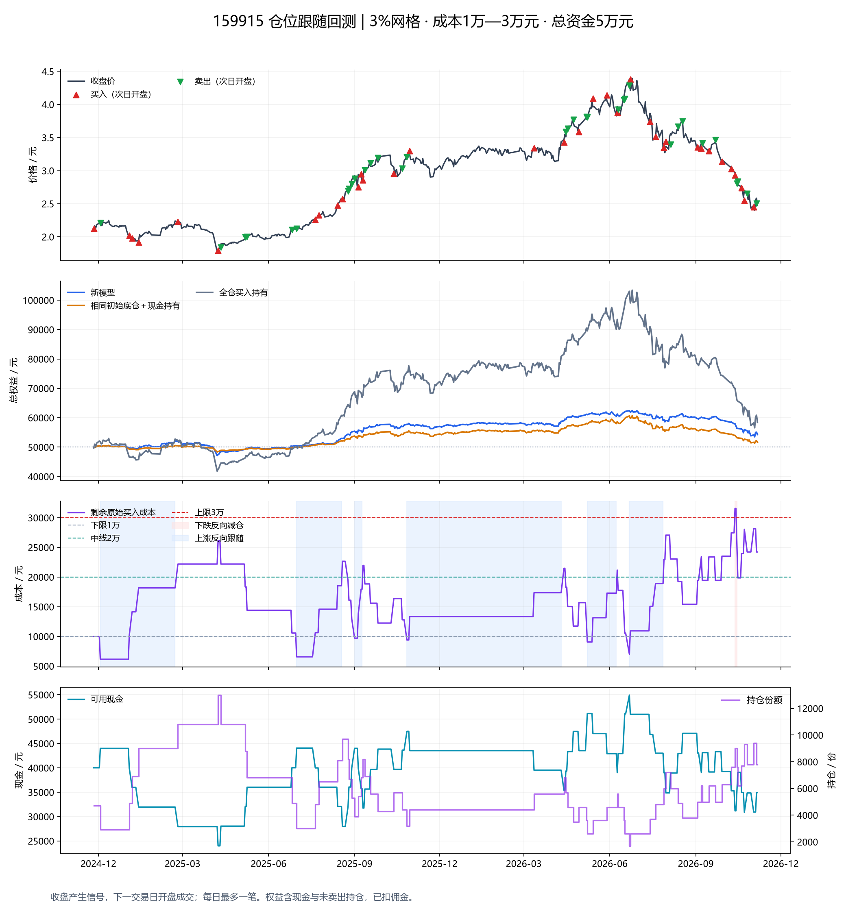

# 159915仓位跟随：近两年回测

> 研究日期：2026年11月7日。沿用上一轮模型和全部主参数，仅延长数据窗口。半年结果独立保留。

数据窗口：**2024-11-07—2026-11-06，485个交易日**。按原起点规则，于2024-11-25识别连续两日小幅下跌，2024-11-26开盘建仓；实际运行472个交易日。

## 1. 主结果

初始50000元，期末权益 **54,274.60元**，净盈亏 **4,274.60元**，累计收益率 **8.55%**，最大收盘权益回撤 **14.28%**。按实际运行日历长度折算的年化收益率约4.31%。

| 方案 | 期末权益 | 累计收益率 | 最大回撤 |
|---|---:|---:|---:|
| 新模型 | 54,274.60元 | 8.55% | 14.28% |
| 相同初始约1万元底仓＋现金持有 | 51,677.60元 | 3.36% | 15.43% |
| 相同5万元全仓买入持有 | 58,400.53元 | 16.80% | 45.27% |

相对初始底仓不动的期末权益差为 **2,597.00元**；相对全仓持有的收益率差为 **-8.25个百分点**。仓位暴露不同，应结合两个基准判断，不能只选更有利的一个。



## 2. 参数和规则

- 初始总资金50000元，底仓约10000元；成本下限10000、中线20000、上限30000元。
- 每笔约4000元，按实际成交价折成最接近的100份整手，整份成交；允许越过成本边界。
- 固定价格网格为初始成交价×1.03ⁿ，报价精度0.001元；相邻上涨3%，下降约2.9126%。
- 正向下跌买、上涨卖最低买价盈利批次；买后成本≥上限转下跌反向减仓，卖后成本≤下限转上涨反向跟随。
- 下跌反向阶段：下跌卖最高买价批次，反弹有足量盈利批次可卖，剩余成本≤中线恢复正向。
- 上涨反向阶段：突破最高剩余买价且目标格为空才跟随买入；回落到空格可买、已占格等待；成本≥中线恢复正向。
- 格子只要仍有份额就不允许重复买入；全部卖完才释放。阶段只随实际成交改变。
- 收盘判断、次日开盘成交；每天最多一笔，跨多格仅处理最远到达格。等待时仍更新访问格。
- 双边佣金万2.5、最低5元；主场景滑点0，无股票印花税和过户费。执行T+1及现金约束，不追加资金。
- 资金／可卖／盈利份额不足取消整笔；次日开盘再次复核必要条件，不把撤单改成另一方向。
- 初始底仓占0号格，初始化从正向开始；期末按收盘计价，不强制清仓。

起点条件也没有修改：窗口前22根日线中，首次出现连续两日收盘下降，累计跌幅1%—6%，次日开盘建仓。没有使用后续收益选择日期，参数未按两年结果调优。

实际建仓：2.122元×4700份，成本9,973.40元。

## 3. 分年表现（连续运行，不逐年重置）

| 年份 | 实际区间 | 区间初权益 | 区间末权益 | 区间盈亏 | 区间收益率 |
|---|---|---:|---:|---:|---:|
| 2024 | 2024-11-26—2024-12-31 | 50,000.00 | 50,092.20 | 92.20 | 0.18% |
| 2025 | 2025-01-02—2025-12-31 | 50,092.20 | 57,554.80 | 7,462.60 | 14.90% |
| 2026 | 2026-01-05—2026-11-06 | 57,554.80 | 54,274.60 | -3,280.20 | -5.70% |

首年和末年均为不完整年度。阶段、格子、持仓、现金跨年连续保留；分年收益用上一年末权益作为分母。

## 4. 交易与阶段

共68笔，包含初始底仓；买入35笔、卖出33笔。发生14次阶段切换，累计佣金340.00元。

| 交易原因 | 笔数 |
|---|---:|
| 初始底仓 | 1 |
| 正向上涨止盈 | 31 |
| 跟随途中回落空格买入 | 9 |
| 反向上涨跟随 | 12 |
| 正向下跌买入 | 13 |
| 反向下跌减仓 | 2 |

| 卖出类型 | 笔数 | 已实现净盈亏 |
|---|---:|---:|
| 正向上涨止盈 | 31 | 13,009.67元 |
| 反向下跌减仓 | 2 | -3,817.71元 |

反向减仓把浮亏变为已实现亏损，同时释放资金并减少后续敞口。不能仅用其已实现亏损断言减仓有害；判断增量效果还需关闭该规则的其他条件相同的权益对照。

### 等待与开盘取消

| 环节 | 原因 | 次数 |
|---|---|---:|
| 收盘等待 | 格子仍有持仓 | 20 |
| 收盘等待 | 盈利批次数量不足完整一份 | 1 |
| 收盘等待 | 未突破最高剩余买价 | 2 |
| 次日开盘取消 | 未突破最高剩余买价 | 1 |

### 全部阶段切换

| 日期 | 操作原因 | 成交价×份额 | 成交后成本 | 阶段变化 |
|---|---|---|---:|---|
| 2024-12-03 | 正向上涨止盈 | 2.211×1800 | 6,153.80 | 正向→上涨反向跟随 |
| 2025-02-24 | 反向上涨跟随 | 2.232×1800 | 22,191.00 | 上涨反向跟随→正向 |
| 2025-07-01 | 正向上涨止盈 | 2.128×1900 | 6,564.00 | 正向→上涨反向跟随 |
| 2025-08-19 | 反向上涨跟随 | 2.575×1600 | 22,659.40 | 上涨反向跟随→正向 |
| 2025-09-01 | 正向上涨止盈 | 2.880×1400 | 9,705.00 | 正向→上涨反向跟随 |
| 2025-09-10 | 跟随途中回落空格买入 | 2.857×1400 | 21,954.20 | 上涨反向跟随→正向 |
| 2025-10-27 | 正向上涨止盈 | 3.209×1200 | 9,400.00 | 正向→上涨反向跟随 |
| 2026-04-13 | 反向上涨跟随 | 3.430×1200 | 21,479.20 | 上涨反向跟随→正向 |
| 2026-05-08 | 正向上涨止盈 | 3.811×1000 | 9,061.50 | 正向→上涨反向跟随 |
| 2026-06-09 | 跟随途中回落空格买入 | 3.877×1000 | 21,173.50 | 上涨反向跟随→正向 |
| 2026-06-22 | 正向上涨止盈 | 4.291×900 | 7,007.40 | 正向→上涨反向跟随 |
| 2026-07-29 | 跟随途中回落空格买入 | 3.346×1200 | 22,939.80 | 上涨反向跟随→正向 |
| 2026-10-13 | 正向下跌买入 | 2.930×1400 | 31,561.40 | 正向→下跌反向减仓 |
| 2026-10-16 | 反向下跌减仓 | 2.840×1400 | 19,865.10 | 下跌反向减仓→正向 |

## 5. 期末与风险约束

| 项目 | 数值 |
|---|---:|
| 期末现金 | 34,930.60元 |
| 期末持仓 | 7800份，8个占用格 |
| 期末现价／持仓市值 | 2.480元／19,344.00元 |
| 剩余原始成本 | 24,231.50元 |
| 已实现净盈亏 | 9,191.96元 |
| 未实现净盈亏（含剩余买入费） | -4,917.36元 |
| 最低现金余额 | 23,991.80元 |
| 成本范围 | 6,153.80—31,561.40元 |
| 最大超上限／低于下限 | 1,561.40／3,846.20元 |
| 最大持仓份额 | 13000份 |
| 期末阶段 | 正向 |

成本上下限是阶段切换阈值，不是严格仓位硬限制：完整订单可以跨过边界。格子占用及反向回中线控制操作节奏，但不限制累计亏损或确认市场底部。

## 6. 执行成本敏感性

| 场景 | 期末权益 | 收益率 | 最大回撤 | 成交笔数 |
|---|---:|---:|---:|---:|
| 主场景 | 54,274.60 | 8.55% | 14.28% | 68 |
| 双边各1个最小价位滑点 | 52,149.70 | 4.30% | 18.70% | 71 |
| 无最低佣金、费率仍为万2.5 | 54,544.85 | 9.09% | 14.10% | 68 |

**一档滑点使累计收益由8.55%变为4.30%，期末权益减少2,124.90元。** 滑点不仅增加实际成交成本，也改变初始成交锚点、各批次买价、阈值取整和后续操作路径；因此不能简单把它理解为从同一组订单中扣除几十元。这个结果提示模型具有路径敏感性，尚不能仅凭主场景收益判断稳定性。这些场景不是参数最优化。

## 7. 与半年回测的关系

半年回测从2026年5月重新建仓，本轮从2024年11月建仓并持续运行。进入2026年5月时，本轮已有不同的成本、现金、阶段和占格情况。因此两年结果不能由半年结果拼接，重叠日期的买卖也不要求相同。

## 8. 数据与验证边界

- [腾讯未复权日线](https://web.ifzq.gtimg.cn/appstock/app/fqkline/get?param=sz159915,day,2024-11-07,2026-11-06,1000,)：485个交易日，使用真实未复权价格核算资金。
- [腾讯前复权对照](https://web.ifzq.gtimg.cn/appstock/app/fqkline/get?param=sz159915,day,2024-11-07,2026-11-06,1000,qfq)：样本每日OHLCV与未复权一致，未检测到调整差异。
- [新浪第二来源](https://money.finance.sina.com.cn/quotes_service/api/json_v2.php/CN_MarketData.getKLineData?symbol=sz159915&scale=240&ma=no&datalen=1023)：同样覆盖485日，日期及每日OHLC全部一致。
- 三份原始响应及各自SHA-256保存在data目录，缓存重跑会重新验哈希并比较数据。
- 未逐份审计基金分红／折算公告，也未独立核验交易所交易日历；若两种复权序列不一致则拒绝回测。
- 使用相同起点、总资金和费用的两个持有基准；逐日权益与期末已实现／未实现净盈亏均核对守恒。
- 日线版本漏掉盘中触格后回撤，不能等同盘中实时网格。开盘可成交是假设，未模拟排队或涨跌停封单。
- 两年一个ETF、一个预先定义起点仍然不足以证明长期有效。

## 9. 复现

```powershell
python -m unittest discover -s research/position_following_v2 -p 'test_*.py' -v
python research/position_following_v2/backtest_two_years.py
```

默认读取本轮独立冻结快照；加`--refresh-data`才重新下载。
`trades.csv`为全部成交；`events.csv`含等待与开盘撤单；`daily.csv`为逐日权益及基准；`results.json`保存完整参数、汇总及敏感性结果；`yearly.csv`为连续账户的分年表现。
